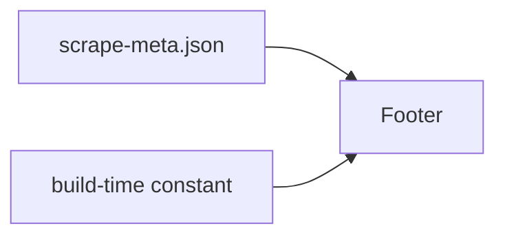

# Architecture Update -- Sprint 048: Footer scrape and site-update dates

## What Changed

The footer component gains a second date. It reads scrape-meta.json `last_updated` (existing) and a new build-time timestamp constant, and formats both in America/Los_Angeles. No new modules.

## Why

Issue 88: distinguish scrape date from deploy date (SUC-001).

## Impact on Existing Components

Footer only. /data-access, /for-agents, llms.txt checked for "last updated" wording and aligned if needed.

## Migration Concerns

None. Takes effect on next deploy.

## Design Rationale

Decision: stamp build time at build, not client side. Alternatives: client clock (wrong meaning). Consequence: static HTML stays cacheable.

## Open Questions

None.

## Architecture Self-Review

Consistency, alignment, design quality, anti-patterns, risks: no issues. Verdict: APPROVE.
